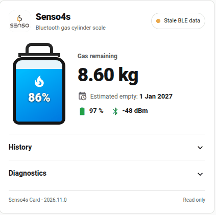
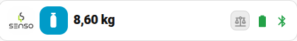

# Senso4s Card

A read-only Home Assistant dashboard card for **Senso4s Basic and Senso4s Plus** Bluetooth gas-cylinder scales. Shows remaining gas, battery, Bluetooth signal, and device status with a choice of compact **Mini** or detailed **Standard** layout.

**Latest stable version: 2026.11.0**

Requires Home Assistant and the [Senso4s Bluetooth integration](https://github.com/Jocke1970/senso4s_ble) with an integrated Senso4s scale.

## Screenshots

**Standard layout**



**Mini layout**



## Installation

### HACS

1. In HACS, add [Jocke1970/HA-Senso4s-Card](https://github.com/Jocke1970/HA-Senso4s-Card) as a custom **Dashboard** repository if it is not already installed.
2. Install **Senso4s Card** and refresh your Home Assistant browser session.
3. Edit a dashboard, add **Senso4s Card** and configure the scale using the visual editor.

HACS should manage the JavaScript resource. Avoid registering a second copy manually.

### Manual installation

1. Download `senso4s-card.js` from the [latest stable release](https://github.com/Jocke1970/HA-Senso4s-Card/releases/latest).
2. Copy the file to `/config/www/senso4s-card.js` in Home Assistant.
3. Add the Lovelace JavaScript module resource `/local/senso4s-card.js` in dashboard resources.
4. Refresh the browser and add the card.

## Configuration

Use the visual editor, or configure the card in YAML:

```yaml
type: custom:senso4s-card
size: standard
language: auto
show_history: true
show_diagnostics: true
history_hours: 168
show_actions: true
demo_mode: off
```

| Option | Description |
| --- | --- |
| `entity` | Optional `sensor.senso4s_…_gas_remaining` entity. Auto-detects if only one scale exists; select explicitly for multiple scales. |
| `title` | Optional card heading; defaults to **Senso4s**. |
| `size` | `standard` or `mini`. |
| `language` | `auto`, `sv`, `en`, `es`, or `fi`. |
| `show_history` | Enable Recorder history in Standard (default: `true`). |
| `show_diagnostics` | Enable diagnostics in Standard (default: `true`). |
| `history_hours` | History range, 1–720 hours (default: 168). |
| `show_actions` | Show disabled action placeholders. Default: on for Standard, off for Mini. |
| `demo_mode` | Preview scenarios in the visual editor; use `off` for real sensor data. |

## Features

- **Mini:** a compact gas-cylinder indicator with remaining kilograms, LOW warning text, battery and Bluetooth status icons, and optional disabled action buttons.
- **Standard:** remaining gas, percentage, estimated empty date, battery, RSSI, expandable history and diagnostics. Plus-specific diagnostics are shown when available.
- **History:** read-only Home Assistant Recorder graphs for gas remaining, battery and Bluetooth signal; the displayed axes use appropriate units and scales.
- **Data freshness:** distinguishes recent BLE contact from a new physical weight reading. Stale or missing data is explicitly indicated.
- **Languages:** Swedish, English, Spanish and Finnish, including automatic Home Assistant language detection.

### LOW warning and colors

The card uses the integration's `low_gas` binary sensor and its configurable `threshold` attribute (5–50%, default 10%). **LOW `on`** takes priority and shows a red gas cylinder, **Låg gasol / Low gas** warning and disabled Refill placeholder (when actions are enabled). **LOW `off`** means no LOW warning, even if the reported percentage is inconsistent.

If LOW is unavailable, the card compares a valid gas percentage with the sensor's threshold attribute; it uses 10% only if no valid threshold is available.

Both layouts follow the same bands: **red at LOW**, **orange above LOW and below threshold + 10 percentage points**, **blue from threshold + 10 and above**, and **grey when gas level is unknown**.

### Preview and read-only behavior

The editor's **Test device (preview only)** selector simulates Basic/Plus, warnings, missing data and different LOW thresholds without changing any real Home Assistant states or issuing device commands. Set **Test device → Off – real Senso4s** when finished.

Refill, calibration and settings buttons are **disabled placeholders**, not working commands. The card cannot change the scale, refill state or integration options.

## Contribute a translation

Want Senso4s Card in another language? You can help by creating a translation file:

1. Copy [`translations/en.json`](translations/en.json) to a new file, for example `translations/de.json`.
2. Translate the **text values** into your language. Keep all JSON keys and any placeholders unchanged; save the file as UTF-8.
3. Open a pull request with your new language file. The language also needs to be registered in the build script and the card's language selector before it can be included in a release.

Translations are **bundled into `senso4s-card.js`**. Copying a JSON file into Home Assistant does not automatically enable the language.

## More information

[Releases](https://github.com/Jocke1970/HA-Senso4s-Card/releases) · [Changelog](CHANGELOG.md) · [MIT license](LICENSE)
